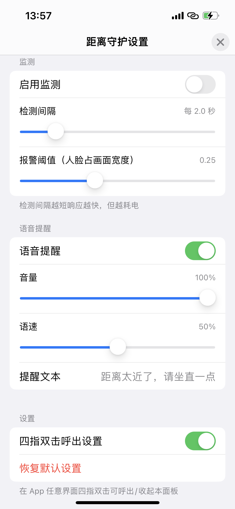

# CloseEyeGuard

iOS 护眼距离守护 —— 前置摄像头 + Vision 实时监测人脸与屏幕的距离，距离过近时语音提醒坐直。**零代码接入**：宿主 App 拖入 framework 即生效。

## 功能特性

- 📷 **零代码接入**：framework 被 dyld 加载后自动启动监测，宿主无需写任何代码
- 👀 **实时监测**：前置摄像头（低分辨率、节流采样，功耗极低）+ Vision 人脸检测
- 🔊 **语音提醒**：距离过近时中文语音播报，文案/音量/语速可调
- ⚙️ **可视化设置面板**：App 内**四指双击**呼出，所有参数滑杆调节、即时生效
- 💾 **配置持久化**：独立 UserDefaults 存储，修改保存后重启 App 依然生效
- 📡 **状态订阅**：Combine 公开 `$isTooClose` / `$currentDistanceCM` / `$isCameraAuthorized`，宿主可联动自己的 UI
- 🔁 **中断自恢复**：来电、其他 App 抢占相机等场景，恢复后自动重启监测

## 环境要求

- iOS 15.6+
- **真机**（iOS 模拟器没有摄像头，无法监测）
- 宿主 App 的 `Info.plist` 需包含：

```xml
<key>NSCameraUsageDescription</key>
<string>用于检测您与屏幕的距离，保护视力</string>
```

 
## 设置面板

App 任意界面**四指双击**呼出/收起设置面板，可调：

| 配置项 | 默认值 | 说明 |
|---|---|---|
| 启用监测 | 开 | 总开关 |
| 检测间隔 | 每 2.0 秒 | 越短响应越快、越耗电 |
| 报警阈值 | 0.25（人脸占画面宽度） | 超过判定为过近 |
| 语音提醒 | 开 | 关闭后仅状态变化，不播报 |
| 音量 / 语速 | 100% / 50% | 播报参数 |
| 提醒文本 | "距离太近了，请坐直一点" | 支持自定义 |
| 四指双击手势 | 开 | 设置面板呼出方式 |

也可在代码中直接配置（即时生效并持久化）：

```swift
let config = CloseEyeGuardConfig.shared
config.checkInterval = 1.0
config.faceWidthThreshold = 0.30
config.warningText = "别凑那么近！"

// 监听距离状态（Combine）
let manager = BackgroundCameraManager.shared
manager.$isTooClose
    .receive(on: DispatchQueue.main)
    .sink { tooClose in
        // 联动宿主自己的 UI，比如遮罩提醒
    }

// 手动控制
manager.stop()
manager.start()

// 摄像头权限被拒时跳转系统设置
manager.openSystemSettings()

// 编程方式呼出设置面板
CloseEyeGuardSettingsPresenter.shared.show()
```


## 已知限制

- **后台不可用**：iOS 不允许普通 App 在后台访问摄像头，监测仅在 App 前台时有效
- **iPad 四指手势**：可能与系统多任务手势（四指捏合/横扫）冲突，触发不稳定；可关闭手势开关，改用 `CloseEyeGuardSettingsPresenter.shared.show()` 编程呼出
- **距离为估算值**：`currentDistanceCM` 基于人像宽度粗略换算，仅供参考；报警判断使用相对阈值
- 报警阈值与摄像头视场角相关，不同机型建议用日志（Console.app 过滤 subsystem `com.xing.CloseEyeGuard`）观察实测值后微调

## 从源码构建

```bash
# 编译验证
xcodebuild -project CloseEyeGuard.xcodeproj -scheme CloseEyeGuard \
  -destination 'generic/platform=iOS' build CODE_SIGNING_ALLOWED=NO

# 打包真机 XCFramework
xcodebuild archive -project CloseEyeGuard.xcodeproj -scheme CloseEyeGuard \
  -destination 'generic/platform=iOS' -archivePath build/CloseEyeGuard.xcarchive \
  SKIP_INSTALL=NO CODE_SIGNING_ALLOWED=NO
xcodebuild -create-xcframework \
  -archive build/CloseEyeGuard.xcarchive -framework CloseEyeGuard.framework \
  -output CloseEyeGuard.xcframework
```

## 设置预览

